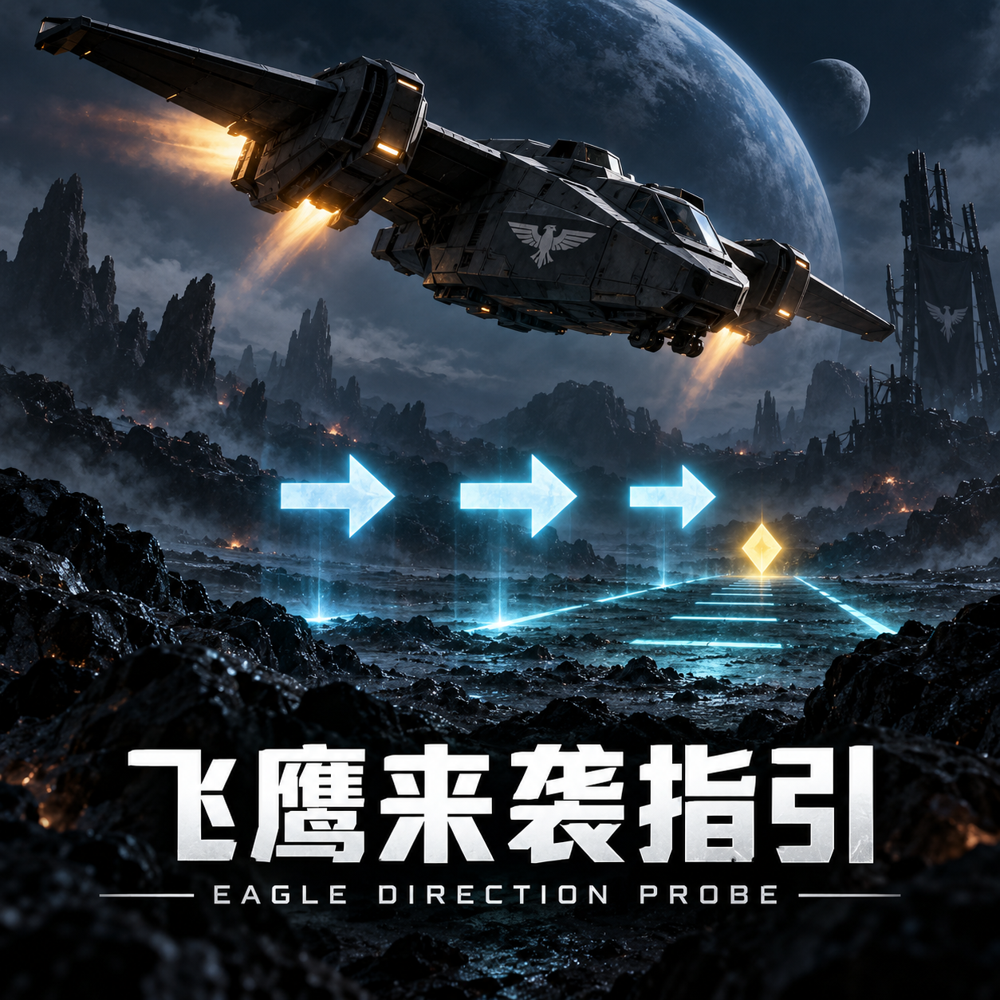

English / [简体中文](https://github.com/Puipipi/HD2-EagleDirectionProbe/blob/main/README_cn.md)

# Eagle Direction Probe



[Download the v1.10.0-rc15 release notes](https://github.com/Puipipi/HD2-EagleDirectionProbe/releases/tag/v1.10.0-rc15) · [Release details](docs/release-1.10.0-rc15.md)

## Current release candidate: 1.10.0-rc15 (2026-10-10)

[Download the ZIP](https://github.com/Puipipi/HD2-EagleDirectionProbe/releases/download/v1.10.0-rc15/HD2-EagleDirectionProbe-1.10.0-rc15.zip). This is a manually imported preview candidate. After importing it, fully exit and restart the game; the addon is not deployed automatically. The optional native-light comparison requires the separately installed Helmet Headlamp resource, which is not included.

The ground border now places vertices at the axial stations in the cached terrain grid, so a narrow peak that was sampled can be represented by the border mesh. It makes no additional terrain queries: the existing limit remains at most two per frame under a 0.5 ms soft budget. Terrain between sampled points can still contain details the interpolation cannot represent.

With **Perspective display** off, the main line requests depth testing, while fill keeps the existing world-GUI path; no extra perspective outline is submitted. With it on, the GUI fill and main line remain, and a separate no-depth-test dashed-outline channel is added. That channel contains component outlines and existing non-fill lines only; it excludes fill surfaces, triangle interior diagonals, scan-fill lines, and text glyph fragments. Text stays in the normal visible rendering. Switching the option rebuilds related ground-geometry caches. Closing, changing worlds, and cleanup release the second line object.

These are the drawing strategies submitted to the engine. Stingray retained-GUI depth comparison and pass ordering have no offline pixel oracle, so actual occlusion behavior still needs in-game confirmation. No per-primitive raycasts were added, and valid guides are not clipped. The addon does not claim that occluded graphics are completely hidden with perspective off, or that only hidden boundaries appear dashed with it on.

The performance status line adds a **guide work** bucket. A frame is included if guide geometry or an owned light object exists at its start or end. The bucket reports mean, sample count, and peak for the complete guarded Lua work and draw time. It does not represent screen-pixel visibility, GPU time, or game FPS.

The final paired offline benchmark used the median of the mean from three runs, with 1/4/8 confirmed guides. With perspective off, rc14 measured 0.0642/0.2457/0.4708 ms/frame and rc15 measured 0.0846/0.2969/0.5065 ms/frame, a regression of about 8–32%. With perspective on, rc15 measured 0.2631/0.8352/1.7510 ms/frame. The rc14 perspective path forced the old line fallback, while rc15 keeps GUI fill and adds outlines, so the workloads differ and ratios are not compared. These are offline Lua/native-mock measurements; they do not cover full in-game pose, native rendering, GPU cost, or prove visibility. The 0.05 ms/frame target has not been reached.

The rc14 native-light and original-resource-white-light modes remain available as diagnostic comparisons. The addon keeps its own lights alive on each draw frame, creates at most one helper per frame, and has no guide-count limit. These comparisons do not prove that a light reaches the ground. Real illumination, perspective pixels, and label readability require manual in-game review. The purple light remains invisible for an unresolved reason; the head-mounted DANGER/PATH? reminder and its polling were removed. Eagle and sky direction arrows, the ground corridor, target diamond, and text panels remain. Player-pose parsing is still used to choose the text viewing side and for the drawing self-test.

rc12–rc14 notes below the current-release section in the Chinese README are local historical validation records and were not separately published; their old candidate packages are not included with rc15.

## Install and inspect

1. Import the release ZIP through your mod manager alongside Bingus Shared Loader v15+ (API 1), then deploy it there.
2. Fully exit and restart the game after importing. No automatic deployment occurs.
3. The optional native-light comparison is off by default and requires Helmet Headlamp 1.0.0 installed separately. Normal direction guides do not require that resource. The package includes neither its resource nor controller code.

The preview candidate ZIP is 2,237,125 bytes; SHA-256: `984fea68052189d08b46c24338be42410aac1dcdc153754cea60e6391a4cdf58`.

## Validation and limits

The published rc15 notes report 330 offline tests passing, successful build gates, LuaJIT 2.1 compilation and packaging checks for 13 Lua resources, and package verification for ZIP CRC, manifest, source payloads, cover, and unchanged terrain resources relative to v1.9.10. The published validation commands are:

```powershell
python -B -m unittest discover -s tests -v
python -B work/standalone/build_probe.py --validate-only
python -B work/standalone/build_probe.py
python -B work/standalone/verify_package.py
```

Offline checks do not establish in-game FPS, light illumination, visual occlusion, or label readability.

Ordinary Eagle direction guidance does not depend on HD2Runtime or another shared runtime package. The optional native light is only a diagnostic prototype. Actual illumination, direction, brightness, and GPU cost remain unverified. The known stratagem range is a user-selected display reference, not a damage or safety boundary. No guide-count limit is imposed.

See [third-party notices](THIRD_PARTY_NOTICES.md) for runtime and development dependencies, read-only references, credits, exclusions, and licensing terms. No new license grant for this project's own code is made by this snapshot.

## Repository map

| Path | Purpose |
| --- | --- |
| `src/eagle_direction_probe.lua` | Addon source |
| `src/cordon_view.lua`, `src/cordon_font.lua` | Corridor drawing and text |
| `src/local_player_pose.lua` | Local-player pose parsing |
| `docs/` | Release notes, design records, and offline benchmark data |
| `dist/` | Mod-manager import packages |

The source tree also documents these development commands:

```powershell
python -B -m unittest discover -s tests -q
python -B tests/offline/run_harness.py
python -B work/standalone/build_probe.py --validate-only
python -B work/standalone/build_probe.py
```

The build does not deploy the addon.
